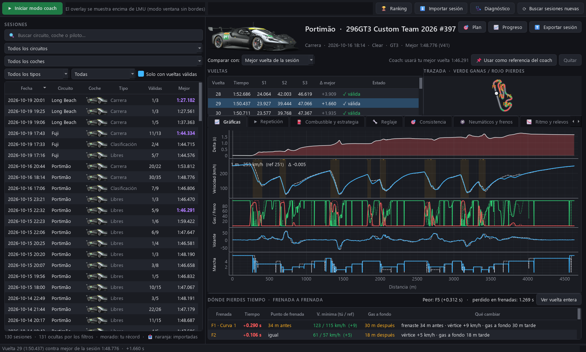
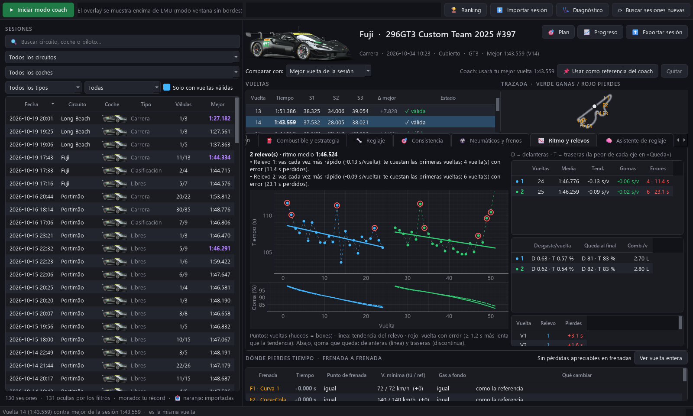
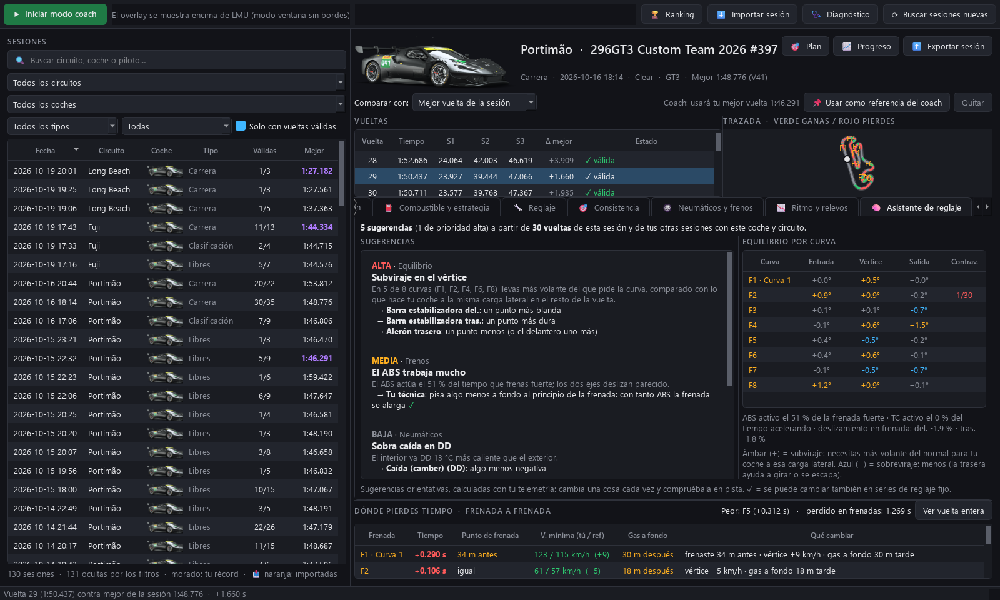
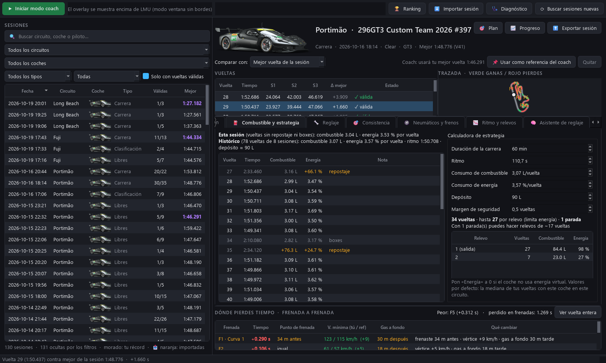
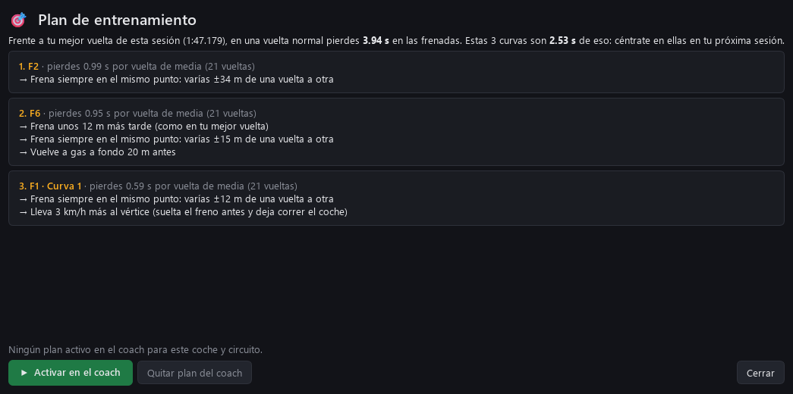
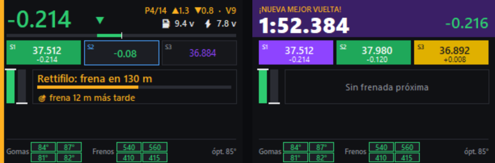

# LMU Coach

App de escritorio para mejorar tus hotlaps en Le Mans Ultimate: analiza todas tus sesiones y tiene un **modo coach** con overlay en directo.



## Instalar

Descarga `LMU-Coach-Setup-x.y.z.exe` de la pestaña **Releases** y ejecútalo. No pide permisos de administrador ni necesita Python. Crea accesos directos a **LMU Coach** y a **LMU Coach - solo modo coach**.
Windows SmartScreen puede avisar de que es una "app desconocida" porque no está firmada: pulsa *Más información → Ejecutar de todas formas*.

Los datos (vueltas grabadas, referencias fijadas, configuración) se guardan en `%LOCALAPPDATA%\LMU Coach`.

Para regenerar el instalador tras cambiar el código, ejecuta `build.bat` (requiere Python 3.12, PyInstaller e Inno Setup 6).

## Configurar Le Mans Ultimate

Solo hace falta hacerlo una vez, dentro del juego:

1. **Activa la grabación de telemetría.** En los ajustes de LMU, activa **«Automatically Record Telemetry»** (o usa el atajo de teclado **«Telemetry Recording»** cuando estés en pista). Sin esto, LMU no guarda las sesiones en `UserData\Telemetry` y la app no tiene nada que analizar. El modo coach sí funciona sin ello.
2. **Pon el juego en «Ventana sin bordes» (Borderless).** En pantalla completa, el coach no se puede ver encima del juego.
3. **Sal a pista.** Los datos en directo del coach solo llegan con el coche en pista, no en el monitor ni en el garaje. Las sesiones aparecen en la app al terminar de rodar: pulsa «⟳ Buscar sesiones nuevas».

No hay que instalar plugins ni tocar archivos del juego: la app lee la telemetría que LMU ya graba y su memoria compartida (`LMU_Data`).

Si algo no funciona, pulsa **🩺 Diagnóstico** en la app. Comprueba que encuentra la carpeta de LMU (si no, deja elegirla a mano), que hay sesiones grabadas, que la grabación de telemetría está activada y que llegan datos en directo.

Si usas varios monitores, el coach se coloca solo en la pantalla del juego. Puedes arrastrarlo a donde quieras y recuerda la posición.

## Desarrollo

Para ejecutarlo desde el código, en Windows con Python 3.12:

```
pip install -r requirements.txt
python -m lmu_coach.gui        # app de escritorio
python -m lmu_coach            # solo el overlay del coach
python -m lmu_coach --demo     # overlay con un coche simulado
```

Atajos (usan Python 3.12 instalado para el usuario):

| | |
|---|---|
| `iniciar.bat` | app de escritorio |
| `iniciar.bat coach` | solo el overlay del coach |
| `iniciar.bat demo` | overlay con un coche simulado (sin el juego) |

## La app

- **Sesiones**: lee las que LMU graba en `UserData/Telemetry/*.duckdb`. Puedes filtrar por circuito, coche y tipo de sesión. En morado aparece tu récord para cada coche y circuito. Para ver las sesiones nuevas, usa "Buscar sesiones nuevas".
- **Imagen del coche**: cada sesión muestra la imagen oficial de su decoración (en la lista y en la cabecera), sacada de la propia interfaz de LMU (`Bin/UI.zip`). Si LMU está abierto al usar la app, aprende la lista completa de decoraciones y la guarda, para que también salgan las más nuevas.
- **Vueltas**: tiempo, sectores (los mejores en morado), diferencia con la mejor y estado (válida, invalidada, boxes).
- **Comparar con**: la mejor vuelta de la sesión o tu mejor vuelta histórica con ese coche y circuito.
- **Gráficas por distancia**: delta, velocidad, gas/freno, volante y marcha. Tu vuelta va en azul y la referencia en discontinua. Las frenadas están marcadas como F1, F2…
- **Trazada**: el mapa del circuito se colorea en verde donde ganas tiempo y en rojo donde lo pierdes.
- **Dónde pierdes tiempo**: tabla frenada a frenada con el tiempo ganado o perdido, el punto de frenada, la velocidad mínima, cuándo vuelves a gas a fondo y qué cambiar. Haz clic en una fila para hacer zoom en esa curva.
- **Nombres de las curvas**: las frenadas llevan el nombre real de la curva en los circuitos conocidos (Rettifilo, Copse, S do Senna…). Haz doble clic en una para ponerle tu propio nombre; el coach y la voz también los usan («pierdes dos décimas en Ascari»).
- **Compartir sesiones**:
  - **⬆ Exportar sesión** guarda la sesión abierta en un archivo `.lmusession`, un zip que ocupa más o menos la mitad que el original.
  - **⬇ Importar sesión** carga un archivo que te hayan pasado. También puedes arrastrarlo a la ventana o hacerle doble clic. Se aceptan `.lmusession`, `.zip` y `.duckdb`.
  - Las sesiones importadas salen en naranja con el nombre del piloto, y se pueden filtrar con «Importadas».
  - No cuentan como tu récord. Sí aparecen en «Comparar con», para enfrentar tu vuelta a la de tu amigo.
  - Con **🗑 Quitar importada** se borra la copia de la app. LMU no se toca.
- **Pestañas de análisis** en cada sesión:
  - **⛽ Combustible y estrategia**: consumo de combustible y energía virtual por vuelta, la media de tus sesiones con ese coche y circuito, y una calculadora de paradas (vueltas por relevo, número de paradas y cuánto cargar en cada relevo).
  - **🔧 Reglaje**: diferencias entre el reglaje de la sesión y el de tu sesión más rápida, o cualquier otra, con los nombres en español.
  - **🎯 Consistencia**: cuánto varía, entre vueltas, tu punto de frenada, la velocidad en el vértice y el tiempo en cada frenada.
  - **🛞 Neumáticos y frenos**: por vuelta y rueda, presión, temperaturas interior/centro/exterior, temperatura máxima del freno y desgaste, con pistas orientativas (presión, caída).
  - **📉 Ritmo y relevos**: tiempos vuelta a vuelta por relevo con su tendencia, cuánto pierdes por vuelta por los neumáticos (descontando el combustible), las vueltas con error y el desgaste de cada eje.
  - **🧠 Asistente de reglaje**: detecta subviraje o sobreviraje por curva y fase (entrada, vértice, salida), cuánto trabajan el ABS y el TC, y las temperaturas de ruedas y frenos. Con eso propone cambios de reglaje ordenados por prioridad. También mira qué valores te dieron mejores tiempos en tus otras sesiones. No usa IA: son reglas de ingeniería aplicadas a tu telemetría. ✓ marca lo que se puede cambiar en series de reglaje fijo.

| Ritmo y relevos | Asistente de reglaje | Combustible y estrategia |
|---|---|---|
|  |  |  |

- **📈 Progreso**: tu mejor vuelta y tu ritmo medio por día, y la **vuelta ideal** con tus mejores sectores de todas las sesiones.
- **🎯 Plan de entrenamiento**: las 3 curvas donde más tiempo pierdes en una vuelta normal frente a tu mejor vuelta, con qué cambiar en cada una (punto de frenada, velocidad de paso, cuándo acelerar). Con «Activar en el coach», el coach te recuerda el objetivo al llegar a esas curvas, en pantalla y por voz.
- **🏆 Ranking**: tus tiempos frente a los de las sesiones importadas de otros pilotos, por circuito y clase, con los mejores sectores de cada uno y dónde os sacáis tiempo.
- **📌 Usar como referencia del coach**: fija la vuelta seleccionada para que el coach la persiga. Con "Quitar", el coach vuelve a usar tu mejor vuelta.



## Modo coach (overlay)



Pulsa **▶ Iniciar modo coach** y entra en pista con LMU en **ventana sin bordes**.

- Delta en directo contra la referencia, con la tendencia (ganando o perdiendo).
- Cuenta atrás hasta cada punto de frenada. Si llegas más rápido que en la referencia, te avisa con "→ frena antes". Si pasas el punto sin frenar, aparece "¡FRENA!".
- Barras de gas y freno, junto a lo que hacías en la referencia en ese mismo punto.
- Feedback al salir de cada frenada.
- **Sectores estilo F1**: el color indica cómo te ha ido en cada sector.
  - Morado: mejor que la referencia.
  - Verde: tu mejor sector de la sesión.
  - Amarillo: más lento.
  - Gris: vuelta no válida.

  El sector en curso muestra el delta en directo, y en la cabecera aparece la **vuelta ideal** (la suma de tus mejores sectores).
- **Combustible y energía**: vueltas restantes de cada uno en la cabecera (⛽ / ⚡), en ámbar o rojo cuando quedan pocas.
- **Avisos por voz** (voz de Windows en español): «frena», cuánto ganas o pierdes en cada frenada, el tiempo de vuelta, si la vuelta se invalida y cuando queda poco combustible. Con clic derecho en el overlay se activan o desactivan, y se elige la voz (por ejemplo Pablo, Laura o Helena, según las que tenga Windows) y la velocidad. Al cambiarlas oyes una frase de prueba.
- **Temperaturas en directo**: una franja bajo el coach con la temperatura de cada goma (verde si está en la ventana óptima del compuesto, ámbar si se aleja, rojo si se pasa y azul si está fría) y de cada freno, comparada con lo que alcanza ese coche en tus sesiones. Si los frenos de un eje se pasan mucho, te avisa por voz. Se oculta con clic derecho → «Temperaturas de gomas y frenos».
- **Ingeniero de carrera** (solo en carreras): arriba a la derecha, tu posición en tu clase y las diferencias con el de delante (▲) y el de detrás (▼). Por voz, al empezar cada vuelta, la posición, las diferencias y si recortas o pierdes tiempo con el de delante. También avisa si tienes un coche de tu clase a menos de 1 s, si ganas o pierdes posiciones, si el de delante o el de detrás entra en boxes, si te alcanza un coche de una clase más rápida, y cuando quedan 5 minutos o 1 vuelta. Se desactiva con clic derecho → «Ingeniero de carrera».
- **Spotter**: avisa por voz cuando tienes un coche al lado («Izquierda», «Derecha», «En medio», «Libre») y marca ese lado del coach con una barra ámbar. Aprende solo qué lado es cuál en las primeras curvas. Se desactiva con clic derecho → «Spotter».
- **Daños**: avisa de golpes que dañan la carrocería, piezas sueltas, pinchazos, ruedas perdidas y motor sobrecalentado, y muestra «⚠ DAÑOS» en el coach.
- **Mensajes ordenados**: los avisos esperan su turno con una pausa entre ellos en vez de pisarse; solo «frena», el spotter y los coches que te alcanzan interrumpen. Los cambios de posición se dicen juntos cuando se estabilizan («Ganas dos posiciones. Posición cinco»).
- **Tiempo de vuelta en grande** durante 6 s al cruzar meta, con la diferencia frente a la referencia. Sale en morado si es tu nueva mejor vuelta y en gris si no es válida.
- Graba automáticamente cada vuelta válida en `data/laps/`.

**Qué referencia usa el coach**:
1. La vuelta que hayas fijado desde la app.
2. Si no hay ninguna fijada, la más rápida entre tus vueltas grabadas por el coach y tu histórico de LMU.

Para mover el overlay, arrástralo. Para cerrarlo, haz clic derecho → Salir, o pulsa Esc.

## Configuración del overlay (`config.json`)

`opacity` (0.93) · `beep_on_brake` (false, pitido en el punto de frenada)

## Técnico

- **Datos en directo**: memoria compartida nativa de LMU (`LMU_Data`). Las estructuras de `lmu_coach/shm_structs.py` están escritas a mano a partir de la documentación que trae el juego en `Support/SharedMemoryInterface`; las cabeceras originales no se redistribuyen. Se lee por sondeo y es compatible con SimHub o CrewChief.
- Proyecto independiente, sin relación con Studio 397 ni Motorsport Games. *Le Mans Ultimate* es una marca de sus respectivos propietarios.
- **Sesiones**: DuckDB. Los resúmenes se guardan en caché en `data/sessions_index.json`.
- **Librerías**: PySide6, pyqtgraph, numpy y duckdb.
