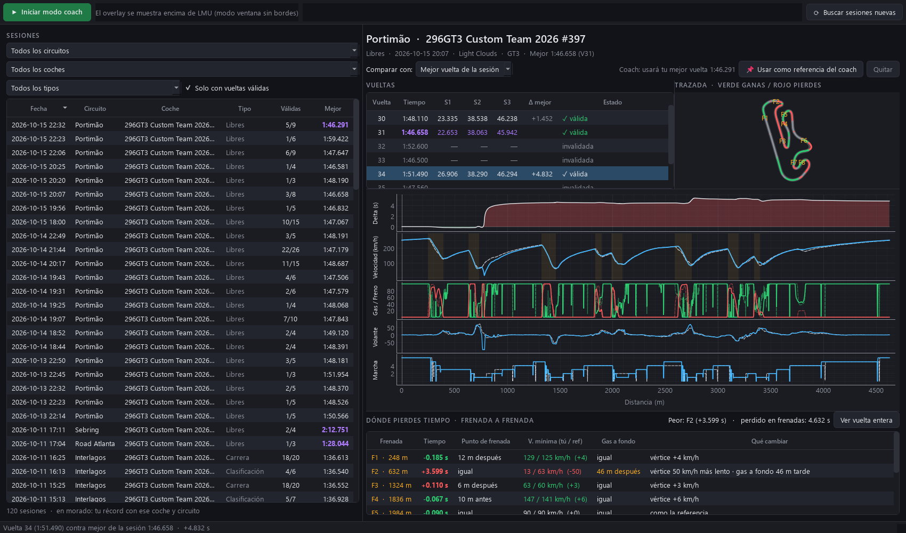

# LMU Coach

App de escritorio para mejorar tus hotlaps en Le Mans Ultimate: analiza todas tus sesiones y tiene un **modo coach** con overlay en directo.



## Instalar

Descarga `LMU-Coach-Setup-x.y.z.exe` de la pestaña **Releases** y ejecútalo. No pide permisos de administrador ni necesita Python. Crea accesos directos a **LMU Coach** y a **LMU Coach - solo modo coach**.
Windows SmartScreen puede avisar de que es una "app desconocida" porque no está firmada: pulsa *Más información → Ejecutar de todas formas*.

Los datos (vueltas grabadas, referencias fijadas, configuración) se guardan en `%LOCALAPPDATA%\LMU Coach`.

Para regenerar el instalador tras cambiar el código, ejecuta `build.bat` (requiere Python 3.12, PyInstaller e Inno Setup 6).

## Desarrollo

Para ejecutarlo desde el código, en Windows con Python 3.12:

```
pip install -r requirements.txt
python -m lmu_coach.gui        # app de escritorio
python -m lmu_coach            # solo el overlay del coach
python -m lmu_coach --demo     # overlay con un coche simulado
```

Atajos (usan Python 3.12 instalado para el usuario):

| | |
|---|---|
| `iniciar.bat` | app de escritorio |
| `iniciar.bat coach` | solo el overlay del coach |
| `iniciar.bat demo` | overlay con un coche simulado (sin el juego) |

## La app

- **Sesiones**: lee las que LMU graba en `UserData/Telemetry/*.duckdb`. Puedes filtrar por circuito, coche y tipo de sesión. En morado aparece tu récord para cada coche y circuito. Para ver las sesiones nuevas, usa "Buscar sesiones nuevas".
- **Vueltas**: tiempo, sectores (los mejores en morado), diferencia con la mejor y estado (válida, invalidada, boxes).
- **Comparar con**: la mejor vuelta de la sesión o tu mejor vuelta histórica con ese coche y circuito.
- **Gráficas por distancia**: delta, velocidad, gas/freno, volante y marcha. Tu vuelta va en azul y la referencia en discontinua. Las frenadas están marcadas como F1, F2…
- **Trazada**: el mapa del circuito se colorea en verde donde ganas tiempo y en rojo donde lo pierdes.
- **Dónde pierdes tiempo**: tabla frenada a frenada con el tiempo ganado o perdido, el punto de frenada, la velocidad mínima, cuándo vuelves a gas a fondo y qué cambiar. Haz clic en una fila para hacer zoom en esa curva.
- **Compartir sesiones**:
  - **⬆ Exportar sesión** guarda la sesión abierta en un archivo `.lmusession`, un zip que ocupa más o menos la mitad que el original.
  - **⬇ Importar sesión** carga un archivo que te hayan pasado. También puedes arrastrarlo a la ventana o hacerle doble clic. Se aceptan `.lmusession`, `.zip` y `.duckdb`.
  - Las sesiones importadas salen en naranja con el nombre del piloto, y se pueden filtrar con «Importadas».
  - No cuentan como tu récord. Sí aparecen en «Comparar con», para enfrentar tu vuelta a la de tu amigo.
  - Con **🗑 Quitar importada** se borra la copia de la app. LMU no se toca.
- **📌 Usar como referencia del coach**: fija la vuelta seleccionada para que el coach la persiga. Con "Quitar", el coach vuelve a usar tu mejor vuelta.

## Modo coach (overlay)

Pulsa **▶ Iniciar modo coach** y entra en pista con LMU en **ventana sin bordes**.

- Delta en directo contra la referencia, con la tendencia (ganando o perdiendo).
- Cuenta atrás hasta cada punto de frenada. Si llegas más rápido que en la referencia, te avisa con "→ frena antes". Si pasas el punto sin frenar, aparece "¡FRENA!".
- Barras de gas y freno, junto a lo que hacías en la referencia en ese mismo punto.
- Feedback al salir de cada frenada.
- **Sectores estilo F1**: el color indica cómo te ha ido en cada sector.
  - Morado: mejor que la referencia.
  - Verde: tu mejor sector de la sesión.
  - Amarillo: más lento.
  - Gris: vuelta no válida.

  El sector en curso muestra el delta en directo, y en la cabecera aparece la **vuelta ideal** (la suma de tus mejores sectores).
- **Tiempo de vuelta en grande** durante 6 s al cruzar meta, con la diferencia frente a la referencia. Sale en morado si es tu nueva mejor vuelta y en gris si no es válida.
- Graba automáticamente cada vuelta válida en `data/laps/`.

**Qué referencia usa el coach**:
1. La vuelta que hayas fijado desde la app.
2. Si no hay ninguna fijada, la más rápida entre tus vueltas grabadas por el coach y tu histórico de LMU.

Para mover el overlay, arrástralo. Para cerrarlo, haz clic derecho → Salir, o pulsa Esc.

## Configuración del overlay (`config.json`)

`opacity` (0.93) · `beep_on_brake` (false, pitido en el punto de frenada)

## Técnico

- **Datos en directo**: memoria compartida nativa de LMU (`LMU_Data`). Las estructuras de `lmu_coach/shm_structs.py` están escritas a mano a partir de la documentación que trae el juego en `Support/SharedMemoryInterface`; las cabeceras originales no se redistribuyen. Se lee por sondeo y es compatible con SimHub o CrewChief.
- Proyecto independiente, sin relación con Studio 397 ni Motorsport Games. *Le Mans Ultimate* es una marca de sus respectivos propietarios.
- **Sesiones**: DuckDB. Los resúmenes se guardan en caché en `data/sessions_index.json`.
- **Librerías**: PySide6, pyqtgraph, numpy y duckdb.
